<div align="center">

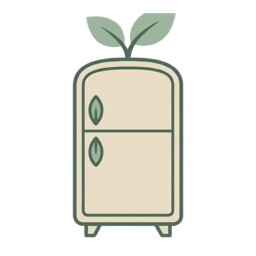

# Freshly

**Scan your groceries, eat them before they expire, and see what you save.**

[](https://kotlinlang.org)
[](https://www.jetbrains.com/compose-multiplatform/)


[](LICENSE)

A **Kotlin Multiplatform** app for Android, iOS and Desktop that helps young people living on their own waste
less food. About **95% of the code is shared**, including the whole UI.

</div>

---

## Table of contents

- [Screenshots](#screenshots)
- [Why Freshly](#why-freshly)
- [Features](#features)
- [Judge's walkthrough (2 minutes)](#judges-walkthrough-2-minutes)
- [How it works](#how-it-works)
- [Kotlin Multiplatform architecture](#kotlin-multiplatform-architecture)
- [Tech stack](#tech-stack)
- [Getting started](#getting-started)
- [Tests](#tests)
- [Troubleshooting](#troubleshooting)
- [Limitations](#limitations)
- [License](#license)

## Screenshots

| Pantry | AI scanner | Smart recipes | Recipe |
|:---:|:---:|:---:|:---:|
| 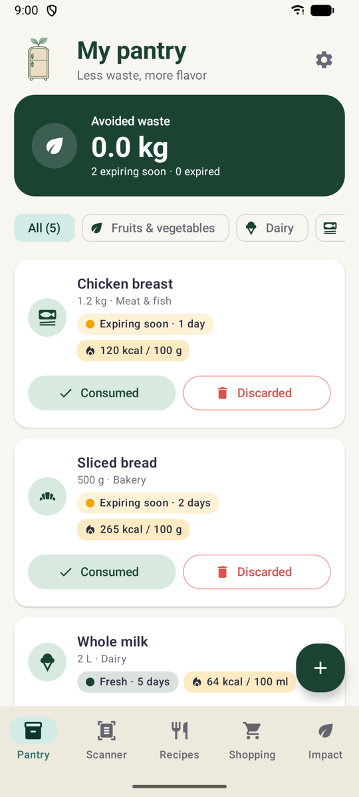 | 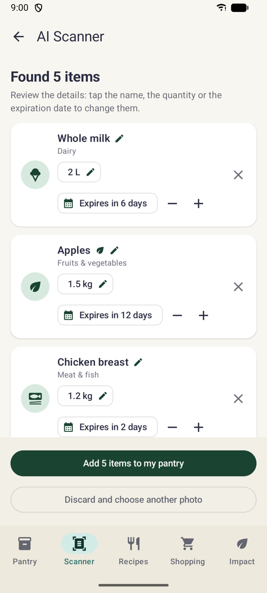 | 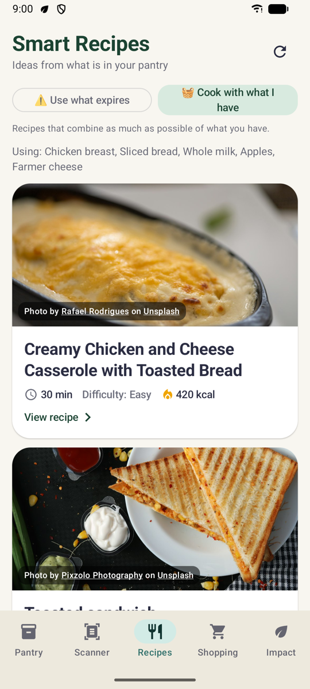 | 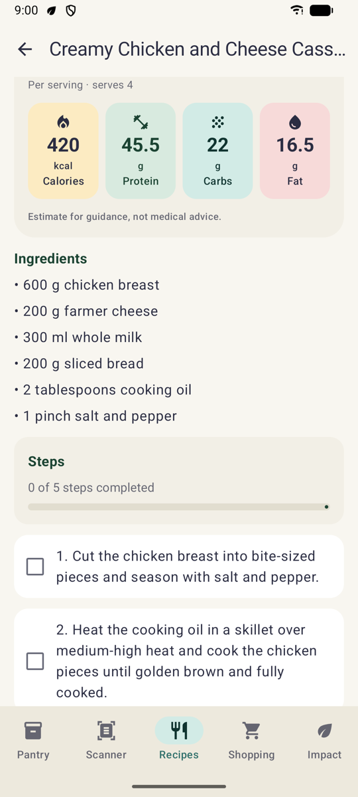 |

| Impact | Shopping list | Notification settings | iOS |
|:---:|:---:|:---:|:---:|
| 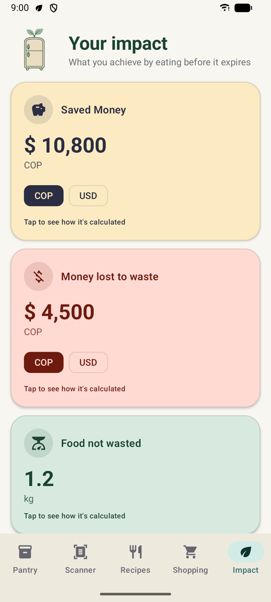 | 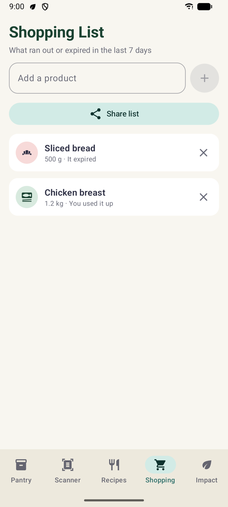 | 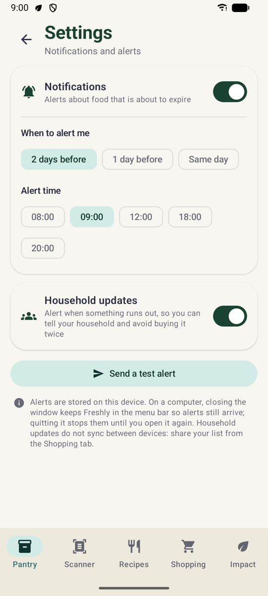 | 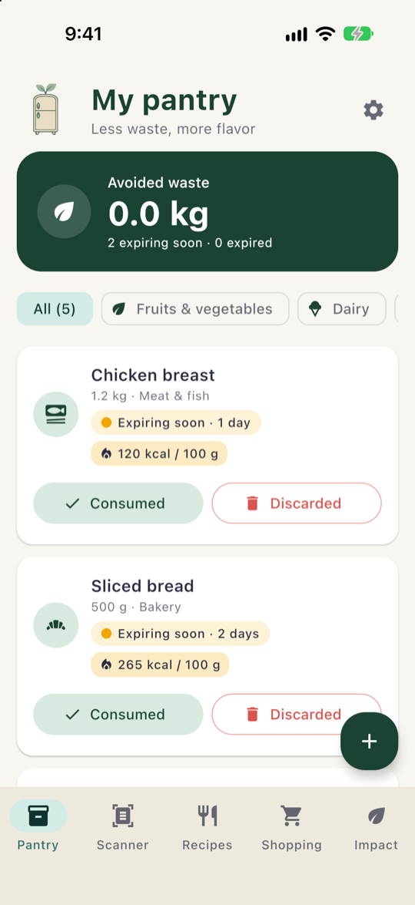 |

**Desktop** (wide windows get a side rail and a multi-column grid):

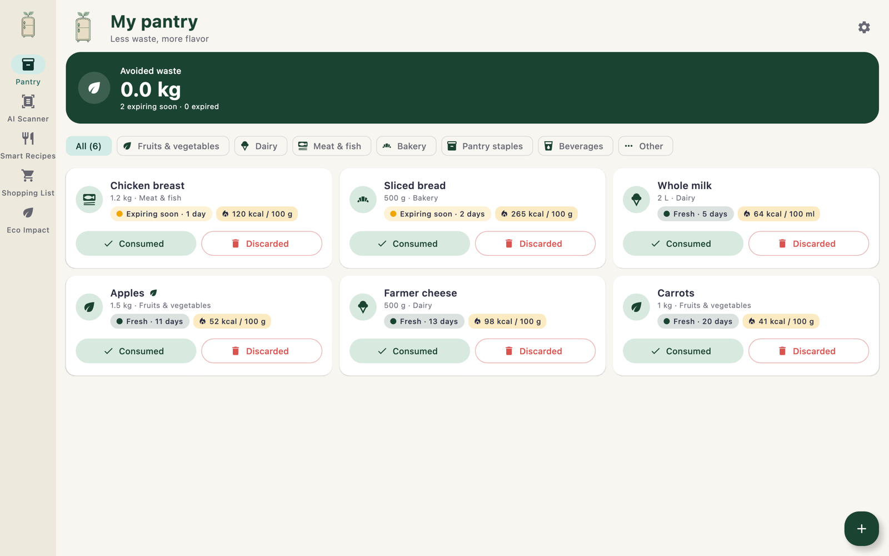

## Why Freshly

### Where the idea comes from

> *"I'll cook it tomorrow."*

That is what my friends say when they open the fridge. Most of them live alone for the first time, between
classes, work and a tight budget. And tomorrow, again and again, ends the same way: the spinach is slimy, the
milk smells sour, the bread has turned green, and food they paid for goes straight into the bin.

Nobody wants to waste food. They simply **forget what they have and when it expires**. Freshly was born to
remember it for them.

### The problem is bigger than one fridge

In 2022 the world wasted **1.05 billion tonnes of food, 60% of it in households**
([UNEP Food Waste Index 2024](https://www.unep.org/resources/publication/food-waste-index-report-2024)),
while **673 million people faced hunger** in 2024
([FAO, SOFI 2025](https://www.fao.org/newsroom/detail/sofi-2025--fao-calls-for-urgent--coordinated-and-inclusive-action-to-end-global-hunger)).
Colombia alone loses or wastes **9.76 million tonnes** of food a year, about a third of what it produces
([DNP](https://www.tetrapak.com/es-co/about-tetra-pak/news-and-events/newsarchive/colombia-pierde-9-76-millones-de-toneladas-de-alimentos-al-ano--)).

And my friends are not an exception: studies find that people who **live alone waste the most food per
person**, and that **young adults waste more than older ones**, mostly because food is forgotten or not used in
time ([household study](https://edspace.american.edu/foodfueled/issues/volume-i/from-the-shelf-to-the-landfill-the-effect-of-socio-demographic-factors-on-wasting-behavior-and-the-impact-of-survey-methods-on-food-waste-reporting/),
[young adults, 2025](https://www.ncbi.nlm.nih.gov/pmc/articles/PMC12538431/)).

### What Freshly solves

| The problem | What Freshly does |
|---|---|
| "I forgot I had it." | One photo of the receipt fills the pantry, with an expiry date for every item. |
| "I didn't see it was going bad." | The pantry is ordered by urgency, and an alert arrives 2 days, 1 day or the same day before, at the hour you choose. |
| "I don't know what to cook with this." | Recipes built from the food that expires first, with or without internet. |
| "It's just a few coins." | The Impact screen shows the money saved and the money lost to waste, in COP or USD. |
| "We both bought milk again." | A household update when something runs out, and a shopping list you can share. |

**An optimization problem.** With a fixed stock of food and limited time, the goal is to eat as much as possible
before it expires. Freshly estimates every expiry date, orders the pantry by urgency (first to expire, first
out), reminds you at the right moment, and turns the items that expire first into recipes.

### How it connects to the SDGs

- **SDG 2, Zero Hunger**: food that is eaten instead of thrown away is food that feeds people, and it stretches
  the budget of young people who live alone.
- **SDG 9, Industry, Innovation and Infrastructure**: AI vision and one Kotlin Multiplatform codebase bring the
  same tool to Android, iOS and Desktop.
- **SDG 12.3**, halving food waste per person, is the target behind every number on the Impact screen.

To be honest about its reach: an app will not end hunger, and every figure it shows is an estimate. But it can
help one household, and one friend, waste less.

## Features

- **AI scanner**: take a photo of a receipt or of your food and Gemini Vision lists the items (name, quantity,
  unit, category, nutrition as sold). Every field can be edited before saving, and the expiry date is
  recalculated when the category changes.
- **Receipt checks**: the receipt date is read and the app warns when the receipt is old, so expiry dates are
  not counted from a purchase made months ago. Spoiled food in a photo is flagged with composting advice.
- **Pantry**: expiry dates estimated per food, category filters, *Consumed* / *Discarded* actions, editable
  quantities, and calories on every item (typical values of its category when it was added by hand).
- **Expired food banner**: a compact banner that unfolds to explain how to dispose of each kind of food
  (compost, organic waste, recycling the container).
- **Hybrid recipes**: Gemini creates recipes with the ingredients closest to expiring, always together with an
  **offline recipe engine**, so recipes keep coming without network, API key or quota. Each recipe has
  servings, calories and macros per cooked serving, and a photo from Unsplash with its credit.
- **Expiration alerts**: local notifications 2 days, 1 day or the same day before food expires, at the hour
  you choose ("⚠️ Whole Milk expires in 2 days! Check recipes to use it before it spoils."). They are
  scheduled when food is scanned, added or edited, and cancelled when it is eaten, thrown away or deleted.
- **Household updates**: a notification when something runs out, so you can share the shopping list and
  avoid buying it twice.
- **Shopping list**: suggestions from what you used up or threw away, products added by hand, and sharing.
- **Impact dashboard**: money saved and money lost to waste (COP or USD), kilograms saved, CO₂e avoided,
  calories, servings and protein.
- **Offline-first and bilingual**: data stays on the device (SQLDelight); English and Spanish follow the
  device language, including the prompts sent to Gemini.
- **Demo Mode**: try the scanner with a sample receipt, no API key needed.

## Judge's walkthrough (2 minutes)

No API key is needed for steps 1 to 5.

1. Open **Scanner** and tap **Load sample receipt (Demo Mode)**. Edit anything you like and tap
   **Add 5 items to my pantry**. Food that expires soon triggers an alert a few seconds later.
2. On **Pantry**, mark an item as *Consumed* (a household update arrives) and another one as *Discarded*.
3. Open **Recipes**, switch between *Use what expires* and *Cook with what I have*, and open a recipe to see
   its steps and nutrition.
4. Open **Impact** to see the money saved and lost, and the **Shopping** list, which now suggests what ran out.
5. Tap the gear on **Pantry** to open **Settings**: change when alerts arrive and tap **Send a test alert**.
6. Optional: add a Gemini key (see [Getting started](#getting-started)) and scan a real receipt or your fridge.

## How it works

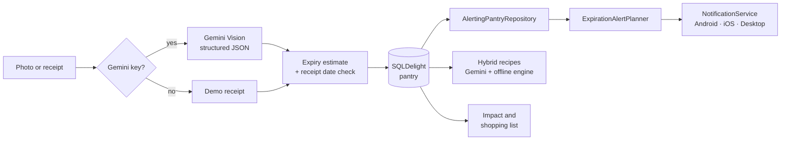

- Every change to the pantry goes through `AlertingPantryRepository`, so the scanner, demo mode, manual entry,
  recipes and the pantry buttons all schedule or cancel alerts the same way.
- `ExpirationAlertPlanner` decides **when** an alert arrives and **what** it says, once, in shared code; each
  platform only delivers it.
- Recipes ask Gemini first and fill the list with the offline engine, which ranks its templates by how many of
  the chosen pantry items they use (the ones expiring first, or everything you have). If Gemini fails, the
  offline recipes are still shown.

## Kotlin Multiplatform architecture

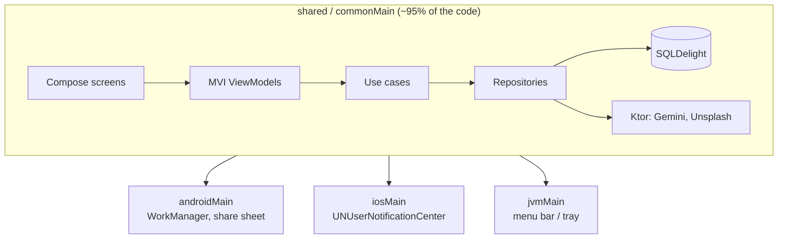

| Source set | Lines of Kotlin | What lives there |
|---|---|---|
| `commonMain` | ~13,200 | Domain, use cases, repositories, Gemini/Unsplash clients, SQLDelight schema, ViewModels, all Compose screens |
| `androidMain` | ~290 | Platform `actual`s + notification worker |
| `iosMain` | ~240 | Platform `actual`s + `MainViewController` |
| `jvmMain` | ~250 | Platform `actual`s + menu bar / tray icon |

Platform code is limited to a small set of `expect`/`actual` declarations:

| `expect` declaration | Purpose |
|---|---|
| `DatabaseDriverFactory` | SQLDelight driver (Android, Native, JDBC SQLite) |
| `ShareService` | Native share sheet for recipes and shopping lists |
| `rememberCameraLauncher` | Camera access for the scanner |
| `PlatformBackHandler` | System back navigation |
| `systemLanguageCode()` | Device language for the UI and AI prompts |
| `NotificationService` | Local notifications: WorkManager + "Pantry Alerts" channel (Android), `UNUserNotificationCenter` calendar triggers (iOS), menu bar / tray icon that keeps the app running (Desktop) |
| `rememberNotificationPermissionRequest` | Notification permission (runtime dialog on Android 13+, system prompt on iOS) |
| `platformModule` | Koin bindings for the platform services |

### Project structure

```
.
├── androidApp/   # Android entry point (Activity, Application)
├── desktopApp/   # Desktop (JVM) entry point, window and menu bar icon
├── iosApp/       # Xcode project and SwiftUI entry point
├── docs/assets/  # Logo and screenshots used in this README
└── shared/
    └── src/
        ├── commonMain/
        │   ├── kotlin/com/ecoalacena/app/
        │   │   ├── core/           # Dates, i18n
        │   │   ├── data/           # Repositories, database, Gemini and Unsplash clients, notifications, demo data
        │   │   ├── di/             # Koin modules
        │   │   ├── domain/         # Models, use cases, offline recipe engine
        │   │   ├── platform/       # expect declarations for platform services
        │   │   └── presentation/   # Screens, ViewModels, theme
        │   ├── sqldelight/         # Database schema and migrations
        │   └── composeResources/   # Shared images
        ├── androidMain/ iosMain/ jvmMain/   # Platform implementations
        └── commonTest/ jvmTest/             # Tests
```

## Tech stack

| Area | Technology |
|---|---|
| Language | Kotlin 2.4 |
| UI | Compose Multiplatform + Material 3 |
| Architecture | Clean Architecture (domain / data / presentation) + MVI ViewModels (State, Intent, Effect) |
| Dependency injection | Koin |
| Database | SQLDelight with `.sqm` migrations |
| Networking | Ktor Client + kotlinx.serialization |
| Dates | kotlinx-datetime |
| AI | Google Gemini API (structured JSON output with a response schema) |
| Images | Coil 3, Unsplash API |
| Camera / gallery | FileKit |
| Notifications | WorkManager (Android), UserNotifications (iOS), AWT SystemTray (Desktop) |

## Getting started

### Requirements

- JDK 21 (Gradle downloads it through toolchains if it is missing)
- Android Studio or IntelliJ IDEA with the Kotlin Multiplatform plugin
- Android SDK (compileSdk 37)
- macOS with Xcode, for iOS only
- Optional: a [Gemini API key](https://aistudio.google.com/apikey) (free) for AI scanning and AI recipes
- Optional: an [Unsplash access key](https://unsplash.com/developers) for recipe photos

Without any key the app still works: the scanner has Demo Mode, recipes come from the offline engine and each
recipe shows the illustration of its category.

### Setup

1. Clone the repository:

   ```bash
   git clone https://github.com/isaromn/freshly.git
   cd freshly
   ```

2. Add your keys to `local.properties` in the project root (Android Studio creates it with `sdk.dir`):

   ```properties
   sdk.dir=/path/to/Android/sdk
   GEMINI_API_KEY=your_gemini_key
   UNSPLASH_ACCESS_KEY=your_unsplash_access_key
   ```

   > `local.properties` is git-ignored. Never commit a real key.

   | Platform | Source of `GEMINI_API_KEY` and `UNSPLASH_ACCESS_KEY` |
   |---|---|
   | Android | `local.properties` or environment variable → `BuildConfig` |
   | Desktop | Environment variable, system property or `local.properties` |
   | iOS | `iosApp/iosApp/Info.plist` (keep them empty in commits) |

### Run

| Platform | Command |
|---|---|
| Android | `./gradlew :androidApp:installDebug` with a device or emulator connected, or *Run* in the IDE |
| Desktop | `./gradlew :desktopApp:run` (hot reload: `./gradlew :desktopApp:hotRun --auto`) |
| iOS | Open `iosApp/iosApp.xcodeproj` in Xcode, pick a simulator and run the `iosApp` scheme |

The iOS build links the system SQLite library through `iosApp/Configuration/Config.xcconfig`.

### About notifications

Notifications are local to each device and need the user's permission, asked on first launch (Android 13+ and iOS).

- **Android**: each alert is a WorkManager job, so it arrives with the app closed and is scheduled again after
  the phone restarts.
- **iOS**: alerts are calendar notifications kept by the system.
- **Desktop**: alerts are messages of Freshly's menu bar (macOS) or tray (Windows/Linux) icon. Closing the
  window keeps Freshly running there, so alerts keep arriving; choose **Quit Freshly** in that icon's menu to
  stop it. A desktop app cannot wake itself up once it has quit, so alerts are planned again the next time it
  starts.
- Household updates are not synced between devices.

## Tests

225 tests in `commonTest` and `jvmTest` cover the offline recipe engine, expiry and alert planning,
nutrition estimates, use cases, repositories (against a real in-memory SQLite database) and ViewModels.

```bash
./gradlew :shared:jvmTest                 # common tests on the JVM
./gradlew :shared:iosSimulatorArm64Test   # common tests on the iOS simulator
```

Line coverage measured with [Kover](https://github.com/Kotlin/kotlinx-kover) on the JVM target:

| Code | Coverage |
|---|---|
| Domain (models, use cases, recipe engine) | 98% |
| Everything except Compose screens | 86% |
| Whole shared module, Compose screens included | 43% |

The Compose screens are checked by hand on Android, iOS and Desktop.

## Troubleshooting

| Problem | What to do |
|---|---|
| "The Gemini API key is not configured" | Add `GEMINI_API_KEY` as shown in [Setup](#setup), or use **Demo Mode** on the Scanner screen. |
| Recipes have illustrations instead of photos | There is no `UNSPLASH_ACCESS_KEY`, or the free limit of 50 searches per hour was reached. Recipes still work. |
| No notifications on Android 13+ | Allow notifications for Freshly in the system settings, then use **Send a test alert** in Settings. |
| Desktop alerts stopped | Freshly was quit from the menu bar icon. Open it again: the alerts are planned again on start. |
| iOS build fails with `sqlite3` symbols | Make sure the target uses `iosApp/Configuration/Config.xcconfig`, which adds `-lsqlite3`. |

## Limitations

- Expiry dates, nutrition, money, CO₂e and equivalences are **estimates** based on averages.
- Data is stored only on the device; there are no accounts and nothing is synced between devices.
- The AI scanner needs a Gemini key from each user. A store release would need a small backend so the key never
  ships inside the app.

## License

Released under the [MIT License](LICENSE).
