<div align="center">


# Freshly

**Scan your groceries, eat them before they expire, and see what you save.**

[](https://github.com/isaromn/freshly/actions/workflows/ci.yml)


[](https://kotlinlang.org)
[](https://www.jetbrains.com/compose-multiplatform/)
[](LICENSE)

**Android · iOS · Desktop** from one Kotlin Multiplatform codebase, UI included.

[⬇️ Android APK](https://github.com/isaromn/freshly/releases/latest) · [⬇️ macOS app (Apple Silicon)](https://github.com/isaromn/freshly/releases/latest) · [▶️ Judge's walkthrough](#judges-walkthrough-2-minutes)

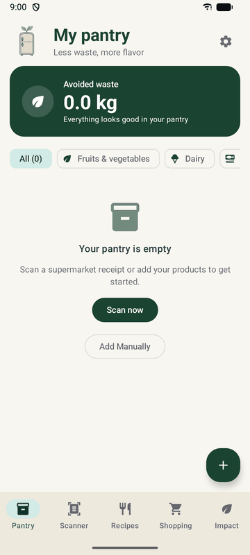

</div>

---

> *"I'll cook it tomorrow."*

That is what my friends say when they open the fridge. Most of them live alone for the first time, between
classes, work and a tight budget, and tomorrow keeps ending the same way: slimy spinach, sour milk, money in the
bin. They don't want to waste food; they **forget what they have and when it expires**. Freshly remembers for them.

| 1.05 B tonnes | 60% | 673 M | 9.76 M tonnes |
|:---:|:---:|:---:|:---:|
| of food wasted in 2022 ([UNEP](https://www.unep.org/resources/publication/food-waste-index-report-2024)) | of it wasted at home ([UNEP](https://www.unep.org/resources/publication/food-waste-index-report-2024)) | people facing hunger in 2024 ([FAO](https://www.fao.org/newsroom/detail/sofi-2025--fao-calls-for-urgent--coordinated-and-inclusive-action-to-end-global-hunger)) | of food lost or wasted in Colombia every year ([DNP](https://www.tetrapak.com/es-co/about-tetra-pak/news-and-events/newsarchive/colombia-pierde-9-76-millones-de-toneladas-de-alimentos-al-ano--)) |

People who live alone waste the most food per person, and young adults waste more than older ones
([household study](https://edspace.american.edu/foodfueled/issues/volume-i/from-the-shelf-to-the-landfill-the-effect-of-socio-demographic-factors-on-wasting-behavior-and-the-impact-of-survey-methods-on-food-waste-reporting/),
[young adults, 2025](https://www.ncbi.nlm.nih.gov/pmc/articles/PMC12538431/)). Freshly is built for them.

## Contents

- [Judge's walkthrough (2 minutes)](#judges-walkthrough-2-minutes)
- [Kotlin Multiplatform highlights](#kotlin-multiplatform-highlights)
- [Screenshots](#screenshots)
- [What Freshly solves](#what-freshly-solves)
- [Features](#features)
- [Technical challenges](#technical-challenges)
- [Architecture and tech stack](#architecture-and-tech-stack)
- [Getting started, tests and limitations](#getting-started)
- [Roadmap](#roadmap)

## Judge's walkthrough (2 minutes)

Install the [Android APK or the macOS app](https://github.com/isaromn/freshly/releases/latest), or
[run it from source](#getting-started). **No API key is needed** for steps 1 to 5.

1. Open **Scanner** and tap **Load sample receipt (Demo Mode)**. Edit anything you like and tap
   **Add 5 items to my pantry**. Food that expires soon triggers an alert a few seconds later.
2. On **Pantry**, mark an item as *Consumed* (a household update arrives) and another one as *Discarded*.
3. Open **Recipes**, switch between *Use what expires* and *Cook with what I have*, and open a recipe to see
   its steps and nutrition per serving.
4. Open **Impact** to see the money saved and lost (COP or USD), and the **Shopping** list, which now
   suggests what ran out.
5. Tap the gear on **Pantry** to open **Settings**: change when alerts arrive and tap **Send a test alert**.
6. Optional: add a Gemini key and scan a real receipt or your fridge. Without a key, recipes come from the
   offline engine.

## Kotlin Multiplatform highlights

- **One UI for three platforms.** Every screen is Compose Multiplatform in `commonMain`, with an adaptive
  layout: a bottom bar on phones, a side rail and a multi-column grid on wide desktop windows.
- **Decide once, deliver natively.** `ExpirationAlertPlanner` decides in shared code *when* an alert arrives and
  *what* it says; each platform only delivers it with its own API.
- **One `expect fun` for the language.** `systemLanguageCode()` drives both the UI texts and the prompts sent to
  Gemini, so the AI answers in the language of the device.
- **Shared data and logic.** SQLDelight (with migrations), Ktor, Koin, the offline recipe engine and the MVI
  ViewModels all live in `commonMain`; about **95%** of the Kotlin code is shared.

```kotlin
// commonMain: one contract for local notifications
expect class NotificationService : ExpirationNotifier {
    override suspend fun scheduleExpirationAlert(item: PantryItem, daysBefore: Int, alertHour: Int, notifyIfLate: Boolean)
    override fun cancelNotification(itemId: String)
    override fun showInstantNotification(title: String, message: String)
    override suspend fun requestPermission(): Boolean
}

// androidMain: a WorkManager job per item, so alerts survive app restarts and reboots
workManager.enqueueUniqueWork("expiry-${item.id}", ExistingWorkPolicy.REPLACE, request)

// iosMain: a calendar trigger kept by the system
val trigger = UNCalendarNotificationTrigger.triggerWithDateMatchingComponents(components, repeats = false)

// jvmMain: a timer while the app lives in the macOS menu bar or the system tray
timer.schedule(delay = triggerAt - now) { DesktopTray.showMessage(alert.title, alert.message) }
```

| Same screen, three platforms | | |
|:---:|:---:|:---:|
| **Android** | **iOS** | **Desktop** |
| 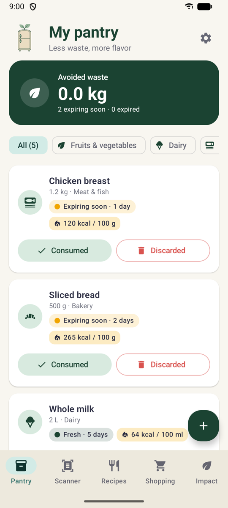 | 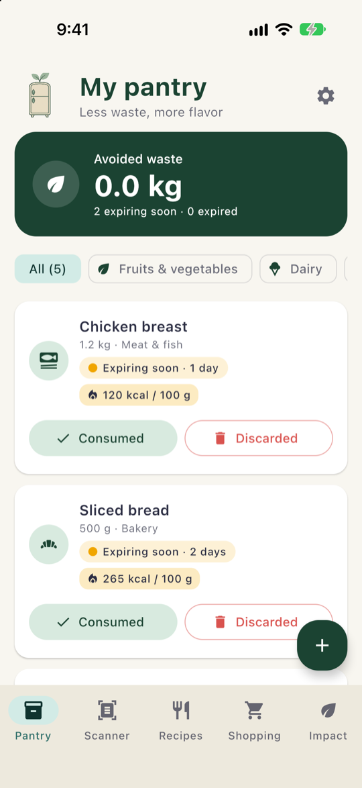 | 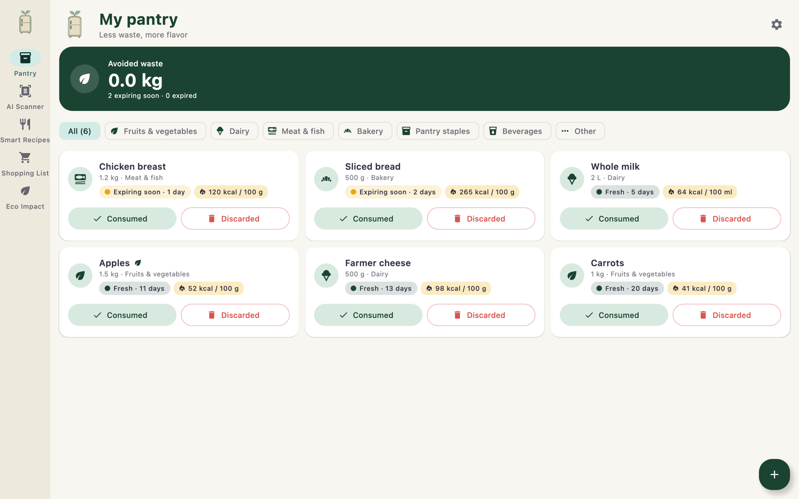 |

## Screenshots

| AI scanner | Smart recipes | Recipe | Impact |
|:---:|:---:|:---:|:---:|
| 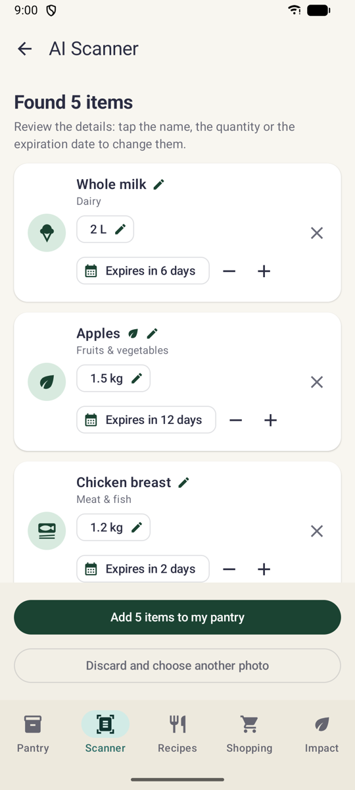 | 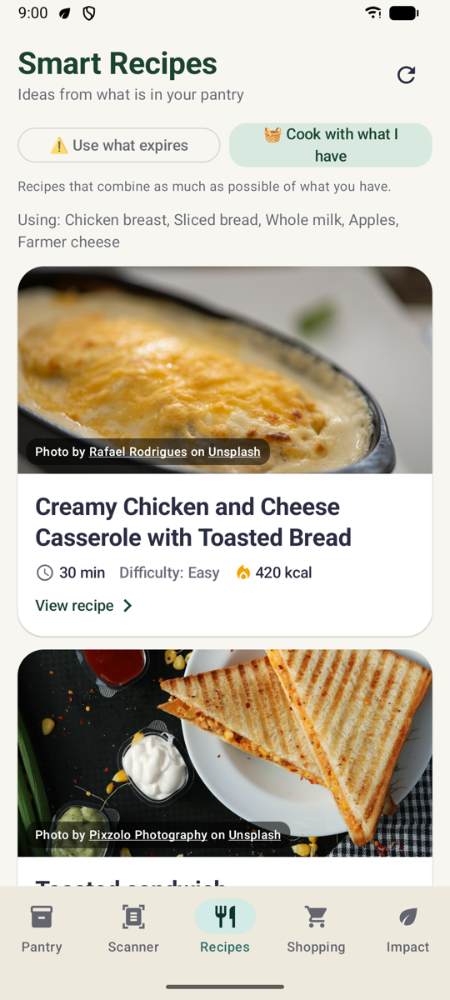 | 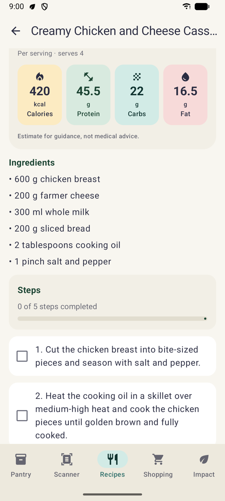 | 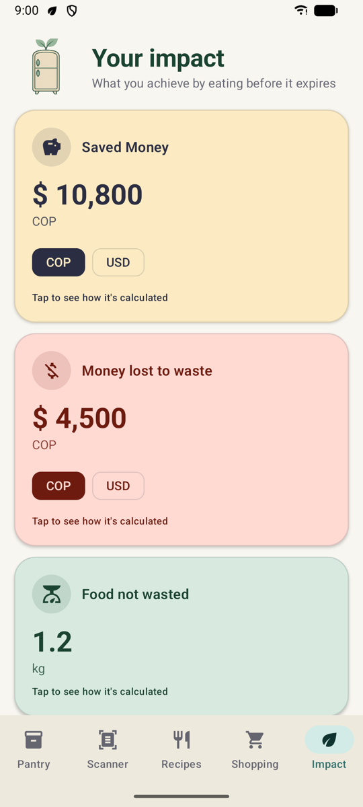 |

| Shopping list | Notification settings | Spanish, dark mode |
|:---:|:---:|:---:|
| 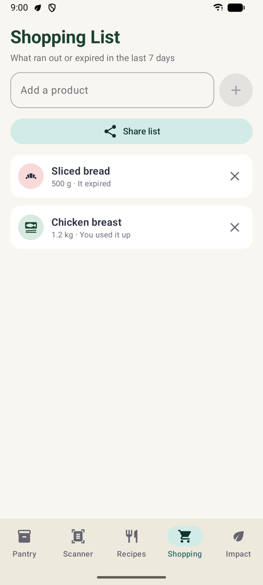 | 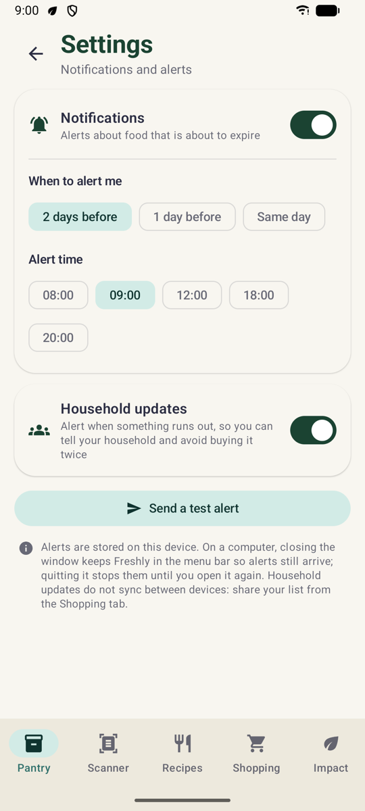 | 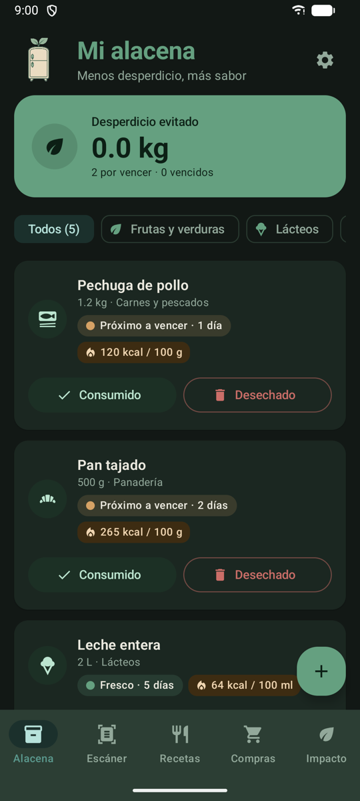 |

## What Freshly solves

| The problem | What Freshly does |
|---|---|
| "I forgot I had it." | One photo of the receipt fills the pantry, with an expiry date for every item. |
| "I didn't see it was going bad." | The pantry is ordered by urgency, and an alert arrives 2 days, 1 day or the same day before, at the hour you choose. |
| "I don't know what to cook with this." | Recipes built from the food that expires first, with or without internet. |
| "It's just a few coins." | The Impact screen shows the money saved and the money lost to waste, in COP or USD. |
| "We both bought milk again." | A household update when something runs out, and a shopping list you can share. |

**An optimization problem.** With a fixed stock of food and limited time, the goal is to eat as much as possible
before it expires. Freshly estimates every expiry date, orders the pantry by urgency (first to expire, first out),
reminds you at the right moment, and turns the items that expire first into recipes.

**SDGs.** Freshly works towards **SDG 2, Zero Hunger** (food eaten instead of thrown away, and a budget that goes
further), **SDG 9, Industry, Innovation and Infrastructure** (AI and one multiplatform codebase in everyday life)
and **SDG 12.3**, halving food waste per person. To be honest about its reach: an app will not end hunger, and
every figure it shows is an estimate. But it can help one household, and one friend, waste less.

## Features

- **AI scanner**: a photo of a receipt or of your food becomes a list of items (name, quantity, unit, category,
  nutrition as sold) through Gemini Vision. Every field can be edited before saving.
- **Receipt checks**: the receipt date is read and old receipts are flagged, so expiry dates are not counted
  from a purchase made months ago. Spoiled food in a photo comes with composting advice.
- **Pantry**: expiry dates estimated per food, category filters, *Consumed* / *Discarded* actions, editable
  quantities, and calories on every item (typical values of its category when it was added by hand).
- **Expired food banner**: a compact banner that unfolds to explain how to dispose of each kind of food.
- **Hybrid recipes**: Gemini recipes with the ingredients closest to expiring, always together with an
  **offline recipe engine**; servings, calories and macros per cooked serving, and Unsplash photos with credit.
- **Expiration alerts and household updates**: local notifications at the hour and lead time you choose, and
  a notification when something runs out.
- **Shopping list**: suggestions from what you used up or threw away, products added by hand, and sharing.
- **Impact dashboard**: money saved and lost (COP or USD), kilograms saved, CO₂e avoided, calories, servings
  and protein.
- **Offline-first and bilingual**: data stays on the device; English and Spanish follow the device language.
- **Demo Mode**: try the scanner with a sample receipt, without an API key.

## Technical challenges

- **A desktop app cannot wake itself up.** Android has WorkManager and iOS keeps calendar notifications, but a
  closed JVM app runs nothing. Closing the window now hides Freshly in the macOS menu bar or the system tray, its
  timers keep running, and `PantryAlerts.keepInSync` plans every alert again on start.
- **Every pantry change must update the alerts.** Instead of touching each screen, `AlertingPantryRepository`
  decorates the repository: the scanner, demo mode, manual entry, recipes and the pantry buttons all schedule
  or cancel alerts through the same path, and a notification error never stops food from being saved.
- **AI that can fail.** Recipes ask Gemini with a JSON response schema and always add the offline engine's
  recipes, so the screen is never empty without network, key or quota.
- **Dates that lie.** Receipt dates are read and checked, so a two-month-old receipt does not produce
  "fresh" milk. Expiry days also respect the user's time zone: at 10 p.m. in Colombia it is already tomorrow
  in UTC, a bug that once moved alerts a day late and is now covered by tests.

## Architecture and tech stack

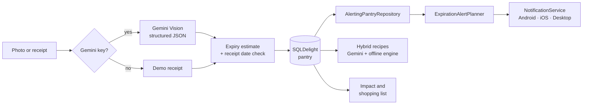

<details>
<summary><b>Source sets and <code>expect</code>/<code>actual</code> declarations</b></summary>

| Source set | Lines of Kotlin | What lives there |
|---|---|---|
| `commonMain` | ~13,200 | Domain, use cases, repositories, Gemini/Unsplash clients, SQLDelight schema, ViewModels, all Compose screens |
| `androidMain` | ~290 | Platform `actual`s + notification worker |
| `iosMain` | ~240 | Platform `actual`s + `MainViewController` |
| `jvmMain` | ~250 | Platform `actual`s + menu bar / tray icon |

| `expect` declaration | Purpose |
|---|---|
| `DatabaseDriverFactory` | SQLDelight driver (Android, Native, JDBC SQLite) |
| `ShareService` | Native share sheet for recipes and shopping lists |
| `rememberCameraLauncher` | Camera access for the scanner |
| `PlatformBackHandler` | System back navigation |
| `systemLanguageCode()` | Device language for the UI and AI prompts |
| `NotificationService` | Local notifications on each platform |
| `rememberNotificationPermissionRequest` | Notification permission (runtime dialog on Android 13+, system prompt on iOS) |
| `platformModule` | Koin bindings for the platform services |

</details>

<details>
<summary><b>Tech stack</b></summary>

| Area | Technology |
|---|---|
| Language | Kotlin 2.4 |
| UI | Compose Multiplatform 1.12 + Material 3 |
| Architecture | Clean Architecture (domain / data / presentation) + MVI ViewModels (State, Intent, Effect) |
| Dependency injection | Koin |
| Database | SQLDelight with `.sqm` migrations |
| Networking | Ktor Client + kotlinx.serialization |
| Dates | kotlinx-datetime |
| AI | Google Gemini API (structured JSON output with a response schema) |
| Images | Coil 3, Unsplash API |
| Camera / gallery | FileKit |
| Notifications | WorkManager (Android), UserNotifications (iOS), AWT SystemTray (Desktop) |

</details>

<details>
<summary><b>Project structure</b></summary>

```
.
├── androidApp/   # Android entry point (Activity, Application)
├── desktopApp/   # Desktop (JVM) entry point, window and menu bar icon
├── iosApp/       # Xcode project and SwiftUI entry point
├── docs/assets/  # Logo, demo GIF and screenshots used in this README
└── shared/
    └── src/
        ├── commonMain/
        │   ├── kotlin/com/ecoalacena/app/
        │   │   ├── core/           # Dates, i18n
        │   │   ├── data/           # Repositories, database, Gemini and Unsplash clients, notifications, demo data
        │   │   ├── di/             # Koin modules
        │   │   ├── domain/         # Models, use cases, offline recipe engine
        │   │   ├── platform/       # expect declarations for platform services
        │   │   └── presentation/   # Screens, ViewModels, theme
        │   ├── sqldelight/         # Database schema and migrations
        │   └── composeResources/   # Shared images
        ├── androidMain/ iosMain/ jvmMain/   # Platform implementations
        └── commonTest/ jvmTest/             # Tests
```

The code package is `com.ecoalacena.app`: *EcoAlacena* ("eco pantry") was the working name of the project before
it became Freshly.

</details>

## Getting started

<details>
<summary><b>Requirements, setup and run</b></summary>

**Requirements**

- JDK 21 (Gradle downloads it through toolchains if it is missing)
- Android Studio or IntelliJ IDEA with the Kotlin Multiplatform plugin
- Android SDK (compileSdk 37)
- macOS with Xcode, for iOS only
- Optional: a [Gemini API key](https://aistudio.google.com/apikey) (free) for AI scanning and AI recipes
- Optional: an [Unsplash access key](https://unsplash.com/developers) for recipe photos

Without any key the app still works: the scanner has Demo Mode, recipes come from the offline engine and each
recipe shows the illustration of its category.

**Setup**

```bash
git clone https://github.com/isaromn/freshly.git
cd freshly
```

Add your keys to `local.properties` in the project root (Android Studio creates it with `sdk.dir`):

```properties
sdk.dir=/path/to/Android/sdk
GEMINI_API_KEY=your_gemini_key
UNSPLASH_ACCESS_KEY=your_unsplash_access_key
```

`local.properties` is git-ignored. Never commit a real key.

| Platform | Source of `GEMINI_API_KEY` and `UNSPLASH_ACCESS_KEY` |
|---|---|
| Android | `local.properties` or environment variable → `BuildConfig` |
| Desktop | Environment variable, system property or `local.properties` |
| iOS | `iosApp/iosApp/Info.plist` (keep them empty in commits) |

**Run**

| Platform | Command |
|---|---|
| Android | `./gradlew :androidApp:installDebug` with a device or emulator connected, or *Run* in the IDE |
| Desktop | `./gradlew :desktopApp:run` (hot reload: `./gradlew :desktopApp:hotRun --auto`) |
| iOS | Open `iosApp/iosApp.xcodeproj` in Xcode, pick a simulator and run the `iosApp` scheme |

The iOS build links the system SQLite library through `iosApp/Configuration/Config.xcconfig`.

</details>

<details>
<summary><b>About notifications</b></summary>

Notifications are local to each device and need the user's permission, asked on first launch (Android 13+ and iOS).

- **Android**: each alert is a WorkManager job, so it arrives with the app closed and is scheduled again after
  the phone restarts.
- **iOS**: alerts are calendar notifications kept by the system.
- **Desktop**: alerts are messages of Freshly's menu bar (macOS) or tray (Windows/Linux) icon. Closing the
  window keeps Freshly running there, so alerts keep arriving; choose **Quit Freshly** in that icon's menu to
  stop it. Once it has quit, alerts are planned again the next time it starts.
- Household updates are not synced between devices.

</details>

<details>
<summary><b>Tests and coverage</b></summary>

225 tests in `commonTest` and `jvmTest` cover the offline recipe engine, expiry and alert planning, nutrition
estimates, use cases, repositories (against a real in-memory SQLite database) and ViewModels. CI runs them on
every push, on the JVM and on the iOS simulator.

```bash
./gradlew :shared:jvmTest                 # common tests on the JVM
./gradlew :shared:iosSimulatorArm64Test   # common tests on the iOS simulator
```

Line coverage measured with [Kover](https://github.com/Kotlin/kotlinx-kover) on the JVM target:

| Code | Coverage |
|---|---|
| Domain (models, use cases, recipe engine) | 98% |
| Everything except Compose screens | 86% |
| Whole shared module, Compose screens included | 43% |

The Compose screens are checked by hand on Android, iOS and Desktop.

</details>

<details>
<summary><b>Limitations</b></summary>

- Expiry dates, nutrition, money, CO₂e and equivalences are **estimates** based on averages.
- Data is stored only on the device; there are no accounts and nothing is synced between devices.
- The AI scanner needs a Gemini key from each user. A store release would need a small backend so the key never
  ships inside the app.
- The macOS app is built for Apple Silicon and is not signed: the first time, allow it in **System Settings →
  Privacy & Security → Open Anyway**.

</details>

## Roadmap

- **Web target** with Compose Multiplatform for Wasm, reusing the same `commonMain`.
- **Household sync** so roommates share one pantry and one shopping list.
- **A small backend** that keeps the Gemini key on the server, needed for a store release.

## License

Released under the [MIT License](LICENSE).
